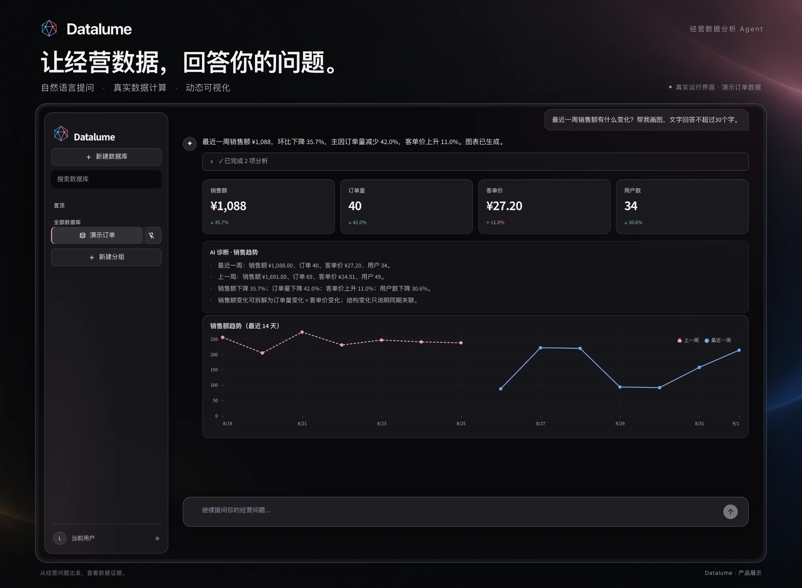

# Prism（棱镜）

**上传订单数据，用自然语言完成经营分析。**


Prism（棱镜）是一个面向订单与零售经营场景的 AI 数据分析 Agent 原型。你可以上传符合字段要求的 CSV / Excel，询问销售变化、商品表现、渠道贡献或复购情况，查看分析结果、图表和 Markdown 经营报告。

项目从一个常见问题出发：看见销售额下降以后，怎样继续拆解，而不止得到一张报表？Prism 将分析方法封装为 Skill，由模型选择分析工具，再交给 Python / Pandas 计算。它适合用来体验经营数据对话，也适合学习 Agent、Skill 与 Tool 如何协作。

## 快速开始

建议使用 Python 3.12。macOS / Linux：

```bash
git clone https://github.com/ellie886/prism.git
cd prism
python3.12 -m venv .venv
source .venv/bin/activate
python -m pip install -r requirements.txt
python -m streamlit run app.py
```

Windows 可将创建环境的命令换为 `py -3.12 -m venv .venv`，再运行 `.venv\Scripts\Activate.ps1` 激活。

打开终端显示的本地地址，通常为 <http://localhost:8501>：

1. 点击「新建数据库」，上传仓库中的 [演示订单数据](data/demo_orders.csv)。
2. 输入「哪个商品销量最高？帮我画出来。」查看回答和图表。
3. 继续询问销售趋势，或通过界面生成、下载经营诊断报告。

**不配置 API Key 也能体验确定性的基础分析。** 多步模型决策、Skill 选择和生成式回答需要可用的 DeepSeek API。启用时先停止应用，复制环境变量示例，在本地 `.env` 中填写自己的 Key 和账户可用的模型名，再重新启动：

```bash
cp .env.example .env
```

[配置示例](.env.example) 中的 Key 默认为空；真实 Key 只保留在本地。

## 可以怎样用

| 想回答的问题 | 当前可以得到的结果 |
| --- | --- |
| 最近一周销售额有什么变化？ | 比较两个七天周期的销售额、订单量、客单价与用户数。 |
| 哪个商品销量最高？帮我画出来。 | 计算商品排名，并按明确画图请求生成可视化。 |
| 渠道表现和复购情况怎么样？ | 在字段支持时，比较渠道销售表现与用户购买情况。 |

下面是项目原名 Datalume 时的真实运行界面展示；当前应用内仍沿用旧名称，其中数字仅属于演示数据。



当前覆盖商品、用户、复购、利润、渠道、趋势、策略七类分析。分析过程可以展开查看，已有结果可以生成 Markdown 报告；多个数据工作区分别保存各自的对话、数据和报告。

## Agent 怎样分析

模型负责理解问题、规划下一步和组织回答，Python / Pandas 负责指标计算。每次工具执行会返回 Observation，Agent 据此决定是否继续分析；默认最多执行四次工具。

比如「最近销售为什么下降？」通常先检查趋势，拆解订单量与客单价，再根据数据能力和工具结果决定是否调查商品或渠道。具体路径由每步结果决定，证据不足时应说明限制。

| Skill | 负责的方法 |
| --- | --- |
| [Business Diagnosis](skills/business-diagnosis/SKILL.md) | 确认经营变化，拆解指标，提出并验证假设。 |
| [Business Metrics](skills/business-metrics/SKILL.md) | 区分销量、销售额、利润等指标，说明口径与工具边界。 |
| [Clarify Analysis Request](skills/clarify-analysis-request/SKILL.md) | 对影响分析方向的关键歧义简短澄清，补充后恢复原任务。 |

请求规划会读取澄清与指标短策略；主分析循环每轮最多加载一个业务 Skill。模型只可调用九个白名单工具，不开放任意 Python、Shell 或通用 HTTP 执行。数字应来自工具结果是当前提示约束，尚无逐数字自动核验器。

详细工具表、加载机制、回退路径与源码入口见 [Agent 与数据说明](docs/agent-guide.md)。

## 数据要求

支持 `.csv`、`.xlsx`、`.xls`。Excel 每次选择一张工作表，首行需要包含以下七列；**当前尚未支持任意结构的企业工作簿**。

| 必填列 | 含义 |
| --- | --- |
| `user_id` | 用户标识 |
| `product` | 商品名称 |
| `price` | 单价，非负数 |
| `quantity` | 数量，正整数 |
| `date` | 可解析的交易日期 |
| `gender` | 性别分组 |
| `grade` | 年级分组 |

`order_id` 可提高订单与复购统计的可靠性；`unit_cost`、`total_cost` 或 `profit` 用于利润分析；`channel` 用于渠道分析。字段缺失会限制可回答的问题。具体别名和计算口径见 [数据说明](docs/agent-guide.md#当前计算口径)。

## 当前边界

- 数据工作区保存在 Streamlit 会话中，应用重启后不保留；尚无持久化或用户权限系统。
- 趋势以数据中的最大日期为基准，比较最近七天与前七天，不代表系统当前日期或自然周。
- 任意日期、人群、商品或渠道筛选及部分指标重排尚未实现；工具接受参数不代表计算已应用筛选。
- 导入会清除完全重复行；销售额按 `price × quantity` 计算，尚未完整建模退款、优惠、税费和退货。
- Excel 不执行公式重算、跨表关联或多行表头整理。利润、复购及渠道效率分析也受字段与口径限制。
- 诊断属于描述性比较和假设验证，相关变化不足以证明因果；模型回答仍需要结合工具证据判断。

## 开发与测试

技术栈：Python、Streamlit、Pandas、Altair、DeepSeek API 与 OpenAI-compatible SDK；Excel 读取使用 openpyxl / xlrd。

```bash
python -m pip install -r requirements-dev.txt
python -m pytest -q
```

自动化测试会禁用真实 DeepSeek Key，覆盖数据导入、业务计算、工具调用、Skill 选择、会话隔离和界面交互。依赖目前使用版本范围，尚未提供锁文件。

## 项目与许可

作者：[ellie886](https://github.com/ellie886) · 仓库：[prism](https://github.com/ellie886/prism)

当前仓库尚未提供 `LICENSE` 文件，本文不新增许可证声明。
