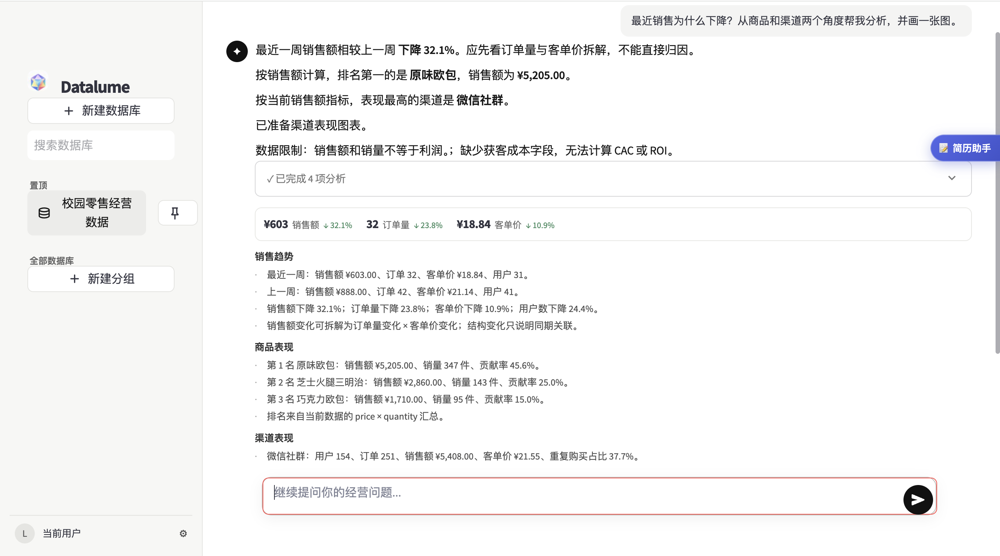
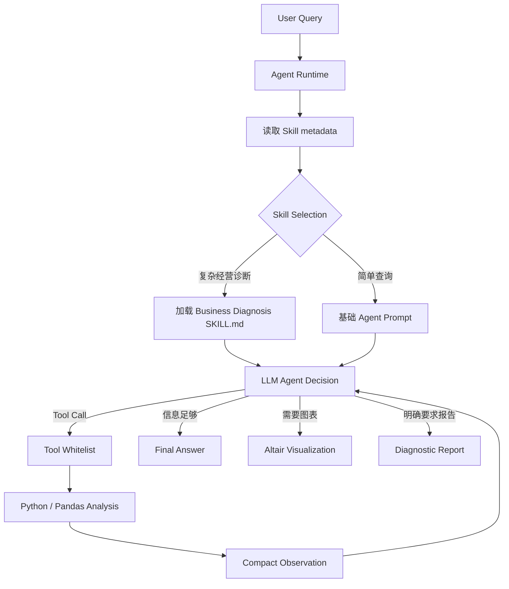

# Datalume

**面向经营分析场景的 AI Data Analysis Agent**

> 上传经营数据，直接用自然语言提问，让 Agent 帮你找到数据变化背后的原因。

Datalume 将自然语言交互与真实数据计算结合。用户无需编写 SQL 或 Pandas，即可完成销售趋势、商品、用户、渠道、复购和利润等经营分析。面对“最近销售为什么下降？”这样的复杂问题，Agent 可以调用经营诊断 Skill，自主选择受控分析工具，并根据每一步数据 Observation 决定下一步。



## What Datalume Can Do

| 用户想知道 | Datalume 可以做什么 |
| --- | --- |
| 最近经营怎么样？ | 分析销售趋势与核心指标变化。 |
| 为什么销售下降？ | 拆解订单量、客单价，并继续定位商品、渠道等可能驱动。 |
| 哪个商品 / 渠道表现最好？ | 基于真实数据计算排名并生成可视化。 |
| 接下来应该做什么？ | 基于已有分析结果形成经营建议。 |

当前实现覆盖商品、用户、复购、利润、渠道、趋势和策略七类分析，并支持动态可视化、Markdown 经营报告和无 LLM 时的确定性分析回退。

多数据库工作区支持创建、搜索、置顶、切换、重命名和二次确认删除。每个数据库使用稳定的 `database_id` 独立保存 CSV、聊天记录、Agent 上下文、分析历史和报告，切换时不会混用状态；当前版本不提供持久化。

## How Datalume Agent Works

> **Datalume 不让 LLM 直接猜数据答案：LLM 负责理解、决策和工具选择，Python / Pandas 负责真实计算。**



### LLM 负责

- 理解用户目标
- Skill Selection
- Tool Selection
- 根据 Observation 决定下一步
- 组织自然语言回答

### Python / Pandas 负责

- CSV 数据校验与清洗
- 核心指标计算
- 分组聚合分析
- 周期比较
- 利润、复购等真实业务计算

核心业务数字必须来自工具返回的 Observation。LLM 不直接读取完整 CSV，也不自行计算或补造指标。

## Business Diagnosis Skill

**Tool Calling 解决 Agent 能做什么，Skill 解决面对一类复杂经营问题应该如何专业完成。**

Datalume 当前的第一个正式 Skill 是 `business-diagnosis`，用于经营变化、下降、异常和问题定位。它定义的方法是：

```text
确认现象
→ 指标拆解
→ 提出最有信息价值的假设
→ 调用 Tool 验证
→ 读取 Observation
→ 接受、降低或排除假设
→ 继续调查或停止
```

例如用户提出：

> 最近销售为什么下降？

```text
analyze_trend
→ Observation：判断订单量 / 客单价哪个变化更明显
→ Business Diagnosis Skill 形成下一步假设
→ 根据数据能力选择 product / channel / user / repurchase Tool
→ 新 Observation
→ 支持、降低或排除假设
→ Final Answer
```

这不是固定 Pipeline。实际路径可以是 `trend → channel`、`trend → product`，也可以在证据充分或字段不足时提前停止。Agent 根据每一步 Observation 动态选择下一步，不会机械调用全部工具；同期结构变化只作为数据支持的判断，不会被表述为已确认因果。

## Agent / Skill / Tool

- **Agent**：决定现在应该做什么。例如先检查销售趋势，再根据订单量变化继续分析渠道。
- **Skill**：定义一类任务应遵循的专业方法。例如经营诊断要求先确认现象，再拆解指标和验证假设。
- **Tool**：执行具体、可审计的数据动作。例如计算商品排名、渠道销售额或最近两周趋势。

## Tools

Datalume 的 Tool Registry 只开放以下 9 个白名单工具：

| Tool | 作用 |
| --- | --- |
| `analyze_product` | 计算商品销量、销售额、贡献率和排名。 |
| `analyze_user` | 计算用户结构、消费贡献和高价值用户。 |
| `analyze_repurchase` | 计算购买次数、复购用户、人群差异和基础 RFM。 |
| `analyze_profit` | 在成本或利润字段可用时计算利润与毛利率。 |
| `analyze_channel` | 计算渠道用户、订单、销售额、客单价和复购表现；字段允许时计算 CAC / ROI。 |
| `analyze_trend` | 比较最近周期与上一可比周期，拆解销售额、订单量和客单价变化。 |
| `analyze_strategy` | 基于已计算经营指标生成策略建议。 |
| `create_visualization` | 为已有分析选择安全的内置图表，不执行模型生成代码。 |
| `generate_report` | 生成确定性的经营诊断报告。 |

Registry 不提供 Shell、任意 Python、文件删除或通用 HTTP 请求工具。

## Progressive Disclosure

`SkillLoader` 采用 metadata-first 发现机制：

1. 默认只读取每个 Skill 的 `name` 和 `description`。
2. Skill Selector 判断当前任务是否需要专业 Skill。
3. 只有被选中的 Skill 才会加载完整 `SKILL.md` 并进入 Agent Prompt。

这样可以减少无关说明进入上下文，并为后续增加更多 Skills 保留清晰的扩展边界。项目目前没有对 token 或成本节省做量化声明。

## Reliability & Guardrails

- **DataCapabilities**：自动检测订单号、成本/利润、渠道及获客成本字段，决定哪些结论可被数据支持。
- **拒绝虚构**：缺少成本时不会把销售额等同利润；缺少渠道时不会用通用建议冒充渠道结论。
- **Hypothesis Testing**：诊断结论必须来自一个或多个 Tool Observation；数据不支持时降低或排除假设。
- **Stop Conditions**：证据足够、用户要求已覆盖、字段不足、继续调用没有信息增量或达到步数上限时停止。
- **Tool whitelist**：模型只能调用预定义工具；未知工具和非法参数会被拒绝。
- **Step limit**：Agent 默认最多执行 4 步，可通过环境变量在 1–8 步之间配置，避免无限循环。
- **No arbitrary execution**：不向 LLM 开放任意 Python、Shell 或 HTTP 执行能力。
- **Compact context**：发送给 LLM 的是字段能力、有限对话上下文和紧凑 Observation，不是完整 CSV 或 DataFrame。
- **Secret management**：DeepSeek API Key 只从环境变量或本地 `.env` 读取，`.env` 已被 Git 忽略。
- **Fallback**：LLM Skill Selection 不可用时先使用保守的确定性 Skill 选择；未选中或加载失败时继续不带 Skill 的 Agent。Tool Calling Agent 失败后回退到单步 LLM 分析；LLM 继续失败或未配置时回退到确定性 Pandas 分析。

## Example Queries

```text
最近销售为什么下降？
哪个商品销量最高？帮我画出来。
哪个渠道表现最好？
复购情况怎么样？
哪个商品利润最高？
接下来应该优先优化什么？
```

分析深度会随 CSV 字段能力变化。例如利润分析需要成本或利润字段，可靠复购分析需要完整 `order_id`，渠道效率分析需要渠道字段。

## Tech Stack

- Python
- Streamlit
- Pandas
- Altair
- DeepSeek API
- OpenAI Python SDK（OpenAI-compatible API / Tool Calling）
- python-dotenv
- pytest

## Project Structure

```text
Datalume/
├── app.py                         # Streamlit 应用入口与交互编排
├── datalume/                      # 核心 Python package
│   ├── agent_runtime.py           # 多步 Agent Loop、停止条件与回退
│   ├── agent_tools.py             # 白名单 Tool Registry
│   ├── agent_models.py            # Agent 状态、Step、Observation 数据模型
│   ├── ai_agent.py               # 单步 LLM 编排与确定性回退
│   ├── deepseek_client.py         # DeepSeek OpenAI-compatible 客户端
│   ├── skill_loader.py            # Skill metadata 发现与按需加载
│   ├── router.py                  # 确定性意图识别回退
│   ├── analysis_engine.py         # 七类真实业务分析
│   ├── data_processor.py          # CSV 校验、清洗、指标与能力检测
│   ├── database_manager.py        # 多数据库状态隔离与管理
│   ├── report_generator.py        # 经营诊断报告与 Markdown 内容
│   ├── ui_components.py           # Datalume UI 组件
│   ├── visualization.py           # 动态 Altair 图表
│   └── assets/                    # 产品品牌资产
├── skills/
│   └── business-diagnosis/
│       └── SKILL.md               # 经营诊断方法与边界
├── data/
│   ├── demo_orders.csv            # 完整 Agent Demo 经营数据
│   └── orders.csv                 # 最小回归测试样例
├── docs/images/                   # 产品真实截图
├── tests/                         # 自动化测试
├── .env.example                   # 安全的环境变量示例
└── requirements.txt               # 运行依赖
```

## Quick Start

```bash
git clone https://github.com/ellie886/Datalume.git
cd Datalume

python -m venv .venv
source .venv/bin/activate

pip install -r requirements.txt
```

复制环境变量示例，并在本地 `.env` 中填写自己的 Key：

```bash
cp .env.example .env
```

不要提交真实 API Key。没有配置 Key 时，应用仍可启动，并会回退到确定性的基础分析模式；多步 LLM Agent 与自然语言生成需要可用的 DeepSeek API。

启动后可创建数据库并上传 `data/demo_orders.csv` 体验完整的商品、用户、渠道、复购、利润与趋势分析。

启动应用：

```bash
python -m streamlit run app.py
```

## Testing

```bash
pip install -r requirements-dev.txt
python -m pytest -q
```

当前版本已通过 **99 automated tests**，覆盖：

- CSV 校验、清洗和 DataCapabilities
- 七类业务分析与数据不足拒答
- OpenAI-compatible Tool Calling 与 Tool whitelist
- 多步 Observation-driven Agent Loop 与停止条件
- Business Diagnosis Skill 选择、加载、假设验证和失败回退
- 多数据库创建、搜索、置顶、切换、重命名、删除及状态隔离
- 动态可视化、报告生成与 Streamlit AppTest

自动化测试会禁用真实 DeepSeek Key，不消耗外部 API。

## Known Limitations

- 当前只有一个正式 Skill：`business-diagnosis`。
- 每轮最多选择一个 Skill；Skill Selection 在 LLM 可用时会增加一次模型请求。
- 多数据库状态保存在 `st.session_state`，应用重启后不会持久化。
- 诊断深度受当前 Tool Observation 粒度和 CSV 可用字段限制。
- 缺少促销、优惠券、实际支付等字段时，无法继续验证部分客单价变化原因。
- 复购可靠性依赖完整订单标识；渠道 CAC / ROI 依赖渠道与获客成本字段。
- 当前诊断属于描述性分析和基于同期证据的判断，不等同于统计因果推断。
